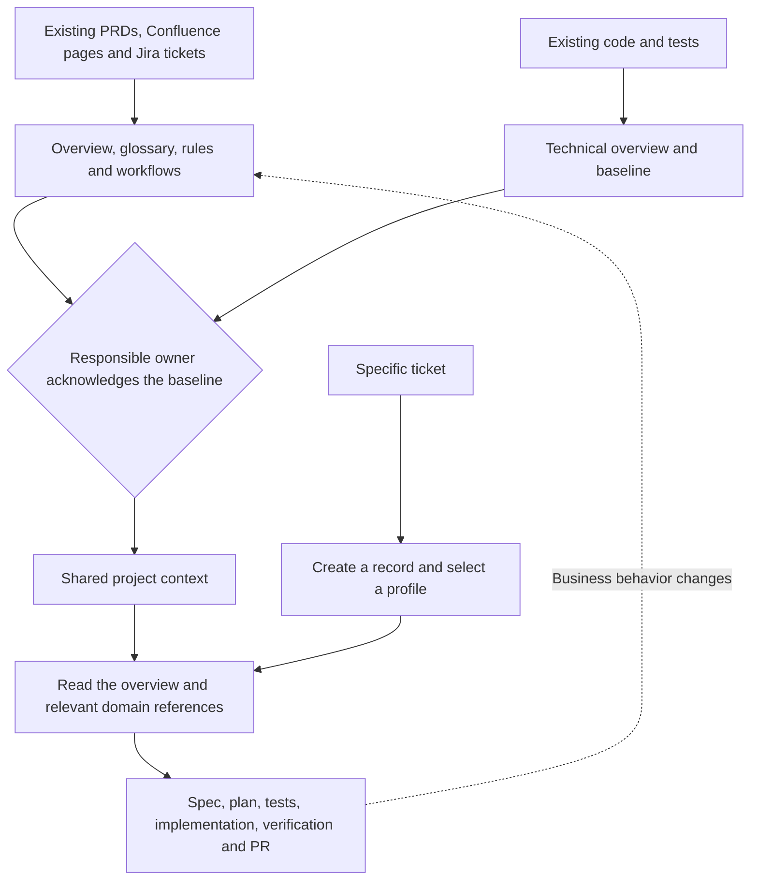
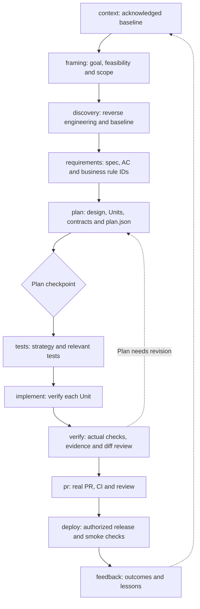
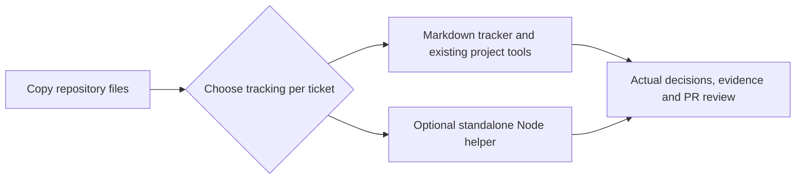
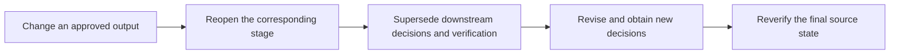

# Portable Workflow and AWS AI-DLC Mapping

This is an adaptation for spec-driven-ai. Sources reviewed on 2026-11-07:

- [AWS repository](https://github.com/awslabs/aidlc-workflows)
- [Phases and Stages](https://github.com/awslabs/aidlc-workflows/blob/main/docs/guide/04-phases-and-stages.md)
- [Workflow Profiles](https://github.com/awslabs/aidlc-workflows/blob/main/docs/guide/workflow-profiles.md)
- [Vision Document](https://github.com/awslabs/aidlc-workflows/blob/main/docs/guide/writing-inputs/vision-document-guide.md)
- [Knowledge](https://github.com/awslabs/aidlc-workflows/blob/main/docs/guide/08-knowledge.md)

The reviewed AWS workflow has 5 phases and 33 stages and does not require a Vision Document to start. This kit uses 11 compact stages and requires an acknowledged business/technical baseline before the first checkpoint. Records may be created earlier. Exhaustive documentation is unnecessary: assign owners to unknowns and resolve questions affecting the ticket.

## Shared Context and Ticket Delivery

## Feature Workflow

Every stage needs outputs and an actual human decision. Unit checkpoints are documented in implementation.md. Neither tracking mode schedules Units/agents or deploys automatically. Work may remain at PR while awaiting review or release.

| Profile | Route |
| --- | --- |
| feature | Complete workflow above |
| bugfix | Omit framing; prioritize reproduction and regression checks |
| refactor | Omit framing; preserve behavior through characterization/regression |
| express | context → requirements → plan → tests → implement → verify → pr; capture necessary investigation in the spec |

## Tracking Modes

Markdown needs no Node.js or installation and has no automatic enforcement. Optional helpers add JSON state, scope checks, fingerprints and receipts. Helpers run from copied files without npm or the source repository. Do not infer helper receipts from handwritten notes.

## AWS Mapping and Limits

| AWS | This Kit | Adaptation |
| --- | --- | --- |
| Initialization | Context and tracker / optional state | Mandatory baseline is a local policy |
| Ideation | framing | Combine intent, scope and feasibility |
| Inception | discovery, requirements, plan | Combine reverse engineering, practices, stories, domain/contracts, Units and delivery planning |
| Construction | tests, implement, verify, pr | Explicit PR checkpoint; execute Units through the workflow |
| Operation | deploy, feedback | Record evidence without automatic pipelines or monitoring |
| Knowledge / DocumentKB | .aidlc/context/business, .aidlc/context/architecture | Markdown/source links, without catalog or extraction services |
| Engine/reviewers/gates | Human process; optional local checks | Not the complete AWS engine, identity service or sandbox |

Profiles do not reproduce AWS's exact routes/counts. Multiple agents are optional. Helper baseline hashes cover four local files, not linked sources. Humans assess business correctness and evidence quality in both modes.

## Revising Approved Work

Changed baselines require acknowledgement and reopening context. In Markdown mode, record superseded decisions explicitly; helper mode handles invalidation through reopen. Never manufacture approvals or evidence.
