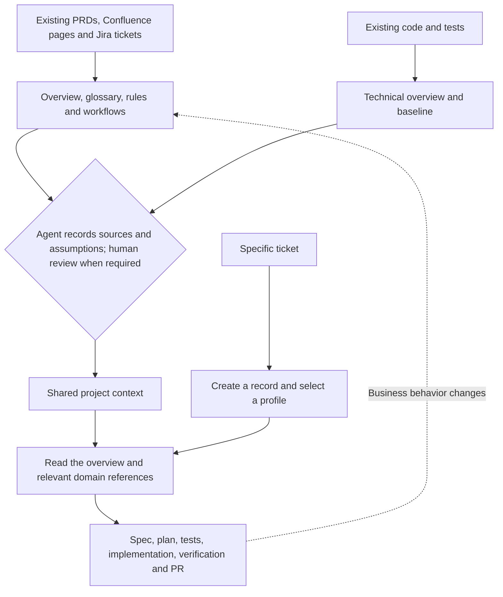
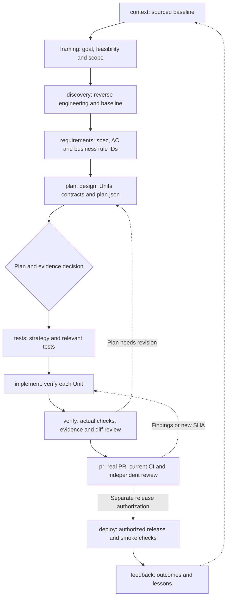
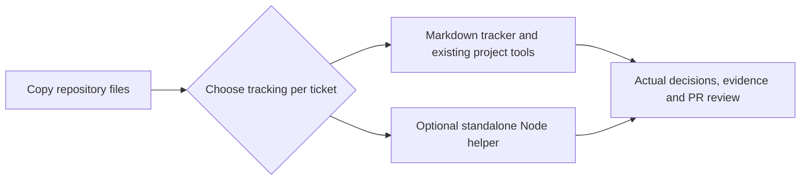
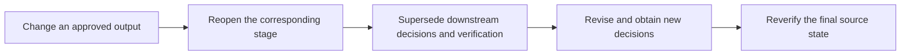

# Portable Workflow and AWS AI-DLC Mapping

This is an adaptation for spec-driven-ai. Sources reviewed on 2026-11-07:

- [AWS repository](https://github.com/awslabs/aidlc-workflows)
- [Phases and Stages](https://github.com/awslabs/aidlc-workflows/blob/main/docs/guide/04-phases-and-stages.md)
- [Workflow Profiles](https://github.com/awslabs/aidlc-workflows/blob/main/docs/guide/workflow-profiles.md)
- [Vision Document](https://github.com/awslabs/aidlc-workflows/blob/main/docs/guide/writing-inputs/vision-document-guide.md)
- [Knowledge](https://github.com/awslabs/aidlc-workflows/blob/main/docs/guide/08-knowledge.md)

The reviewed AWS workflow has 5 phases and 33 stages and does not require a Vision Document to start. This kit uses 11 compact stages and uses a sourced business/technical baseline before stage progress. Records may be created earlier. Exhaustive documentation is unnecessary: record unknowns and resolve material questions affecting the ticket.

## Shared Context and Ticket Delivery

## Feature Workflow

Every stage needs complete outputs and evidence. Autonomous mode is default: coordinator delegates architect -> qa-tester -> coder -> auditor, assesses results and records agent progress/revise decisions without routine user checkpoints. Only coordinator delegates; specialists return findings. Reviewed mode and legacy records retain actual human decisions. The CLI tracks evidence rather than scheduling agents or enforcing OS permissions. The bundled company policy continues through a real PR/current SHA, mandatory CI and independent review/fix loops using jira-to-github.md. A local draft/helper stage completion is insufficient. Honor existing PR authorization; merge/deploy/Jira writes need separate authorization. Generic helper without company config retains local-draft compatibility. See ticket-autopilot.md and USER_GUIDE.md#multi-agent-collaboration for scopes, setup Units and truthful fallback.

| Profile | Route |
| --- | --- |
| feature | Complete workflow above |
| bugfix | Omit framing; prioritize reproduction and regression checks |
| refactor | Omit framing; preserve behavior through characterization/regression |
| express | context → requirements → plan → tests → implement → verify → pr; capture necessary investigation in the spec |

## Tracking Modes

Markdown needs no Node.js or installation and has no automatic enforcement. Optional helpers add JSON state, scope checks, fingerprints and receipts. Helpers run from copied files without npm or the source repository. Do not infer helper receipts from handwritten notes.

## AWS Mapping and Limits

| AWS | This Kit | Adaptation |
| --- | --- | --- |
| Initialization | Context and tracker / optional state | Sourced baseline is a local policy |
| Ideation | framing | Combine intent, scope and feasibility |
| Inception | discovery, requirements, plan | Combine reverse engineering, practices, stories, domain/contracts, Units and delivery planning |
| Construction | tests, implement, verify, pr | Units, exact-HEAD audit, real PR/CI/review-fix loops under company policy |
| Operation | deploy, feedback | Record evidence without automatic pipelines or monitoring |
| Knowledge / DocumentKB | .aidlc/context/business, .aidlc/context/architecture | Markdown/source links, without catalog or extraction services |
| Engine/reviewers/gates | Four role prompts, agent decisions and optional local checks | Not the complete AWS engine, identity service or sandbox |

Profiles do not reproduce AWS's exact routes/counts. Native subagent execution depends on the harness; otherwise use a disclosed separate-session or single-context fallback without claiming independent review; such fallback cannot satisfy company independent-review completion. Context hashes cover four local baseline files, not linked sources; verification additionally includes effective policy and initialized submodule content recursively. Humans assess business correctness and evidence quality in both modes.

## Revising Approved Work

Changed baselines require a new agent observation and revising context in autonomous mode; reviewed mode requires actual acknowledgement/reopen. In Markdown mode, explicitly supersede downstream decisions. Never manufacture approvals or evidence.
