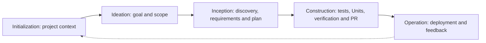

# spec-driven-ai — Portable AI-DLC Workflow Kit

> **Languages / Ngôn ngữ**: [🇬🇧 English](README.md) | [🇻🇳 Tiếng Việt](README.vi.md)

A portable Jira-to-GitHub delivery workflow: give the coding assistant a ticket and it coordinates context, spec, QA, code, independent review and a real PR with required CI/review evidence. Copy the kit into the target project. Tracking needs no npm installation; real Jira/GitHub delivery uses your available authorized accounts/tools.

**Take the contents of [`kit/`](kit/) into your target repository root**, including the hidden `.aidlc` directory and the thin `AGENTS.md` bridge. Preserve existing project files and merge conflicting instructions or documentation deliberately.

The assistant must load the bridge instructions. If the project already has AGENTS.md, preserve it and merge a short direction to `.aidlc/workflows/ticket-autopilot.md`, or mention that path once when starting. A hidden folder alone is not automatically discovered by every tool.

```text
your-project/
├── AGENTS.md                  # Thin entry point for coding assistants
└── .aidlc/
    ├── company.json           # Jira/GitHub policy; mandatory commands and PR delivery
    ├── agents/                # Architect, QA, coder and independent auditor prompts
    ├── rules/
    ├── workflows/             # Five phases, eleven stages
    ├── context/
    │   ├── business/
    │   └── architecture/
    ├── specs/
    │   ├── active/
    │   ├── archive/
    │   └── templates/
    ├── docs/                  # Start Here, User Guide and Workflow
    └── tools/                 # Optional standalone Node helpers
```

## Copy into a Project

You can copy the files manually with your file manager, including hidden files. Or, from this repository, use the optional copy helper:

```sh
node scripts/copy-kit.js ../my-project
```

The helper copies only missing files, reports conflicts and never edits the target package.json or Git hooks. It does not overwrite existing AGENTS.md, business documents or other files. Review and merge reported conflicts before using the workflow.

The bundled `.aidlc/tools/package.json` only isolates CommonJS parsing for the standalone helpers. It has no dependencies or scripts and lets the helpers run inside projects using `"type": "module"` without changing the host project.

On Windows, create a portable archive with:

```powershell
powershell -NoProfile -ExecutionPolicy Bypass -File scripts/package-kit.ps1
```

The archive contains the kit's root files, exactly AGENTS.md and .aidlc/ at its top level. Extract its contents into the target project after reviewing conflicts. Packaging never overwrites an existing archive.

Packaging refuses source symlinks/junctions/reparse points and linked output ancestors before creating an archive. Use ordinary source files and an output directory outside the kit.

## Start with Your Coding Assistant

Open the target project and ask:

> Implement JIRA-1024: [ticket link or pasted content].

The bundled company default is autonomous pull-request delivery: the assistant gathers accessible context, fills missing docs, writes spec/plan and AC-derived unit tests before business implementation, records valid behavioral red, implements to green, runs real checks, independently reviews exact HEAD, publishes/reuses the actual GitHub PR and repairs CI/review findings until required conditions pass. A draft file or PR creation alone is not completed delivery. See [company rollout](kit/.aidlc/docs/COMPANY_ROLLOUT.md) and [Jira-to-GitHub workflow](kit/.aidlc/workflows/jira-to-github.md). No separate bootstrap request or routine stage confirmation is needed. It asks only about essential missing access or material business ambiguity. The core workflow needs only Markdown and your normal development environment. For ticket tracking without automation, use .aidlc/specs/templates/MANUAL_TRACKER.md. Optional local helpers require Node.js >=16 and Git:

```sh
# Run in the target project after copying the kit.
node .aidlc/tools/cli.js help
node .aidlc/tools/cli.js new JIRA-1024 --profile bugfix
```

There is no install or init command. Helpers run entirely from the copied files. The helper does not fetch Jira or run models; the coding assistant uses available authorized tools. A private link still needs access or pasted content. Honor existing user/session authorization for ticket-branch pushes, PR updates, reviewer requests and labeled AI review COMMENT; never forge human APPROVE/self-approval. Merge, deploy and Jira writes require separate authorization. No hooks are installed.

Only the coordinator delegates to four separate roles when the harness supports separate contexts: architect → qa-tester → coder → auditor. Read [Multi-Agent Collaboration](kit/.aidlc/docs/USER_GUIDE.md#multi-agent-collaboration) for native subagent setup, exact write scopes and the disclosed separate-session or single-context fallback. Company completion requires actual independent review; a disclosed single-context fallback can prepare work but cannot satisfy that requirement. The Markdown prompts are portable contracts; the kit does not launch model processes, register IDE agents automatically or enforce an OS-level permission sandbox.

## Lifecycle



A compact adaptation of [AWS AI-DLC](https://github.com/awslabs/aidlc-workflows): 5 phases and 11 stages, with feature, bugfix, refactor and express profiles. See the [diagrams and mapping](kit/.aidlc/docs/WORKFLOW.md) and [user guide](kit/.aidlc/docs/USER_GUIDE.md). Actual verification evidence is required: real PR URL, matching current source SHA, mandatory local/CI outcomes, independent review and required repository review policy with no blocking findings. Autonomous agent decisions are default; reviewed mode and legacy records retain actual human checkpoints. Use `--mode reviewed` only when required. An uncommitted copied kit is supported through the autonomous record's initial dirty snapshot; later changes remain scoped, and no silent commit is made. Manual tracking is not automatically enforced; local helper receipts do not authenticate identity, query remote CI/reviews or guarantee zero regressions. Without company configuration the generic helper retains local-draft compatibility; policy/doctor inspect local settings/readiness without claiming live authentication.

## Maintain This Repository

`kit/` is the canonical portable payload. Root AGENTS.md and the entire .aidlc/ tree are byte-for-byte mirrors of the kit, including starter context templates. Preserved project-specific context drafts are in MAINTAINER_CONTEXT.md, outside the portable payload; they are not an acknowledged baseline for a target project. Keep shared copies synchronized.

```sh
npm test
node scripts/check-kit.js
npm run test:package
```

The root package.json is private and provides optional maintainer test aliases only. It is not included in the kit. MIT; see LICENSE and the license notice bundled with the optional helpers.

`npm test` runs seven independent suites using Node.js and Git, with three suites in parallel by default. Set `AIDLC_TEST_JOBS=1` for serial execution; each suite uses isolated disposable repositories. Any failed suite makes the command fail. `test:package` separately checks ZIP round-trips, ESM consumers and junction rejection; it requires Windows PowerShell on Windows or `pwsh` elsewhere.
