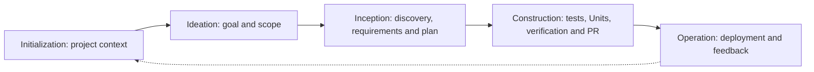

# spec-driven-ai — Portable AI-DLC Workflow Kit

An English-language collection of rules, workflows, business-context templates and ticket artifacts to copy into another project. No plugin, npm package installation, account or dependency changes are required.

**Take the contents of [`kit/`](kit/) into your target repository root**, including the hidden `.aidlc` directory and the thin `AGENTS.md` bridge. Preserve existing project files and merge conflicting instructions or documentation deliberately.

```text
your-project/
├── AGENTS.md                  # Thin entry point for coding assistants
└── .aidlc/
    ├── rules/
    ├── workflows/             # Five phases, eleven stages
    ├── context/
    │   ├── business/
    │   └── architecture/
    ├── specs/
    │   ├── active/
    │   ├── archive/
    │   └── templates/
    ├── docs/                  # Start Here, User Guide and Workflow
    └── tools/                 # Optional standalone Node helpers
```

## Copy into a Project

You can copy the files manually with your file manager, including hidden files. Or, from this repository, use the optional copy helper:

```sh
node scripts/copy-kit.js ../my-project
```

The helper copies only missing files, reports conflicts and never edits the target package.json or Git hooks. It does not overwrite existing AGENTS.md, business documents or other files. Review and merge reported conflicts before using the workflow.

The bundled `.aidlc/tools/package.json` only isolates CommonJS parsing for the standalone helpers. It has no dependencies or scripts and lets the helpers run inside projects using `"type": "module"` without changing the host project.

On Windows, create a portable archive with:

```powershell
powershell -NoProfile -ExecutionPolicy Bypass -File scripts/package-kit.ps1
```

The archive contains the kit's root files, exactly AGENTS.md and .aidlc/ at its top level. Extract its contents into the target project after reviewing conflicts. Packaging never overwrites an existing archive.

Packaging refuses source symlinks/junctions/reparse points and linked output ancestors before creating an archive. Use ordinary source files and an output directory outside the kit.

## Start with Your Coding Assistant

Open the target project and ask:

> Read AGENTS.md and .aidlc/docs/AI_DLC_START_HERE.md. Bootstrap our business and technical context using the AI-DLC workflows. Identify assumptions for my review before implementing tickets. Use Markdown tracking and our existing development tools.

The core workflow needs only Markdown and your normal development environment. For ticket tracking without automation, use .aidlc/specs/templates/MANUAL_TRACKER.md. Optional local helpers require Node.js >=16 and Git:

```sh
# Run in the target project after copying the kit.
node .aidlc/tools/cli.js help
node .aidlc/tools/cli.js new JIRA-1024 --profile bugfix
```

There is no install or init command. Helpers run entirely from the copied files. No API calls, hooks, merges or deployments happen automatically.

## Lifecycle



A compact adaptation of [AWS AI-DLC](https://github.com/awslabs/aidlc-workflows): 5 phases and 11 stages, with feature, bugfix, refactor and express profiles. See the [diagrams and mapping](kit/.aidlc/docs/WORKFLOW.md) and [user guide](kit/.aidlc/docs/USER_GUIDE.md). Human decisions and actual verification evidence remain essential. Manual tracking is not automatically enforced; local helper receipts do not authenticate identity or guarantee zero regressions.

## Maintain This Repository

`kit/` is the canonical portable payload. Root AGENTS.md and the entire .aidlc/ tree are byte-for-byte mirrors of the kit, including starter context templates. Preserved project-specific context drafts are in MAINTAINER_CONTEXT.md, outside the portable payload; they are not an acknowledged baseline for a target project. Keep shared copies synchronized.

```sh
npm test
node scripts/check-kit.js
npm run test:package
```

The root package.json is private and provides optional maintainer test aliases only. It is not included in the kit. MIT; see LICENSE and the license notice bundled with the optional helpers.

`npm test` runs the lifecycle suite plus focused regressions using Node.js and Git. `test:package` separately checks ZIP round-trips, ESM consumers and junction rejection; it requires Windows PowerShell on Windows or `pwsh` elsewhere.
